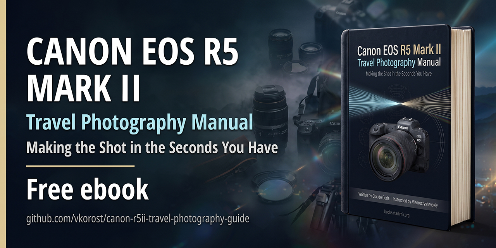
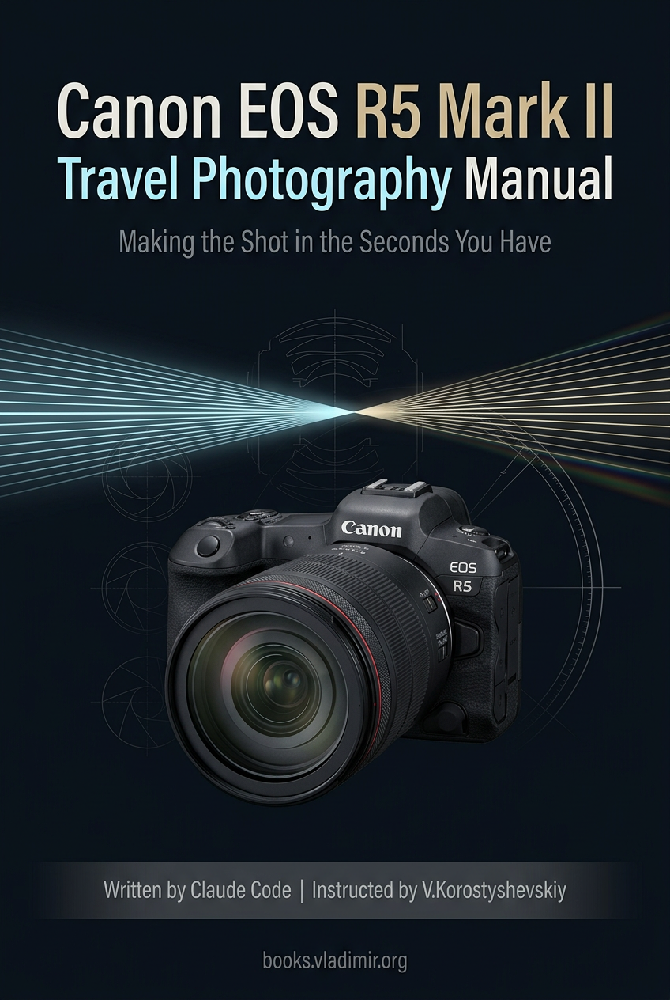

# Canon EOS R5 Mark II

### Travel Photography Manual

A 301-page guide to one camera, built around the way a traveler actually uses it, and an account of the method that produced it. Free to download, in PDF, DOCX and EPUB.

**Stills only.** The movie tabs, the movie-side customization table and everything about recording are out of scope, and the book says so where a reader might expect otherwise. A guide that pretends to cover both covers neither.

## Not a chatbot's answer

Ask a chatbot how to set up a camera and you get a **closed-book exam**: the answer comes from whatever the model half remembers, and a wrong menu path arrives in the same confident tone as a right one, which is a sound reason to distrust the whole answer.

This book was an **open-book exam**. The assistant worked from documents put in front of it: Canon's *EOS R5 Mark II Advanced User Guide*, menu addresses read out of that PDF's own index links, photographs of the camera, and reports other owners have published. Every factual claim says where it came from, and where one rests on a single owner's report rather than on Canon's documentation, the sentence says so. Where the documents did not settle a question, I own the camera and went and looked.

Open book does not mean error-free, and no book ever is. Manufacturers ship manuals with errata pages, and books by human experts get corrected in the second printing. What is different here is that the errors are published instead of quietly fixed: [`docs/ERRORS.md`](docs/ERRORS.md) lists every one that was caught while the book was being built, and what caught it. Judge the process on that list rather than on the word *AI*.

## Why this book exists

I came to the R5 Mark II from a Canon EOS 5DS R I had shot with for almost ten years. That is a long way to jump in one step, and I wanted a manual to catch up on the new hardware and set it up for the way I work. I tried a few of the R5 Mark II guides that already exist and none of them fitted: a great deal of detail I did not need, and not enough of what I did.

I am not a professional photographer either, and I do not shoot every day. I shoot when I travel, a few times a year, so by the time the next trip comes round I have forgotten most of what I worked out on the last one. What I wanted was a camera I could configure once, custom modes included, and a refresher I could read before each trip.

So I had Claude build it. The book combines Canon's own manual with what other R5 Mark II owners have published, fitted to my hardware and my habits. The chapters follow **where your hands are on the body** rather than the feature list, every setting carries its **full menu path**, and the lens advice is written for the lenses actually in the bag. I also handed over a few dozen of my own frames, so the book could work from what I photograph rather than from what I say I photograph.

Shooting a few times a year causes two particular problems, and the book is built around both of them.

**Settings that stay set.** You change something for one scene, the moment passes, and the camera goes on obeying you. Nothing in the viewfinder tells you anything is wrong, and at the magnification you review at the files look fine. I have found the damage later, at home, in pictures I could not take again. The book flags every setting that can behave this way, and for the rest it says which ones you set once and never touch again.

**Customization you cannot remember.** Reassigning buttons and building custom modes is worth doing. Recalling six months later what you changed, and why, while standing in front of something you want to photograph, is a different matter. The book records the reasoning next to each decision, so the configuration can be rebuilt or questioned rather than merely trusted.

## Why it is on GitHub

Not mainly so that people read this particular book about this particular camera. Probably nobody else has my exact combination of body, lenses and habits. The point is that **anyone working with an AI assistant can now build the equivalent for their own gear**, and the best moment to do it is the week after buying a camera. It does not have to be Claude, and you do not have to be an expert in any of this.

What that takes is in [`docs/`](docs/): exactly what I did, how I did it, and what went wrong on the way. To most visitors here, that account is worth more than the book.

The ingredients are modest: an **AI assistant**, the **manufacturer's manual**, a **few photographs of the hardware**, and **reports of how other owners actually use it**. The two things no assistant supplies are **someone who owns the hardware to say *that is wrong***, and the discipline to label what you do not know.

## Download

The book is attached to the [latest release](../../releases/latest) in three formats: **PDF** for a tablet or e-reader, **EPUB** for a phone or Kindle, and **DOCX** if you want to edit it, all free to download with no paywall and no registration.

It is typeset for a 6.75 × 9 in page with a 5.75 in text column, and the figures are leveled for a sixteen-gray e-paper panel, because that is what it was built to be read on.

## What is in the book

- **Part I** walks the body control by control: what each one does, what it can be reassigned to, what other photographers put on it, and whether that is sensible.
- **Part II** covers what you set once: the custom menu, the three custom shooting modes, and the register of settings that cost you quietly when you forget to change them back.
- **Part III** leaves the camera: aperture and diffraction, which lens to carry, light you did not choose, holding the camera still, photographing objects behind glass, people who move, framing in two seconds, and what can and cannot be fixed afterwards.
- **Appendix A** is the manufacturer's own customization matrix with its icon-only column headers resolved into names, so it can finally be searched.
- **Appendix B** is the camera's whole menu as an address book: every secondary tab by number and name, all 181 stills items with what each does and when you would want it, and an alphabetical index.
- **Appendix C** is every source, chapter by chapter. **Appendix D** is the whole book on one page: the field card.

Three conventions run through it. **Menu paths** give every setting its full address: the main tab, the numbered secondary tab with its name, and the item as the camera spells it. **Case boxes** hold the specifics of one photographer's kit, marked so you can skip them. **Work-it-out boxes** give the arithmetic rather than the number, so the method survives a change of kit.

## What is in this repository

| | |
|---|---|
| [`docs/METHOD.md`](docs/METHOD.md) | the recipe, step by step, why each step exists, how the book gets built, and what it takes to do this for your own hardware |
| [`docs/ERRORS.md`](docs/ERRORS.md) | every error the AI made, and how each one was caught |
| [`docs/FIGURES.md`](docs/FIGURES.md) | the figure problem: how a book like this gets its illustrations |
| [`docs/RESEARCH.md`](docs/RESEARCH.md) | how claims were sourced, graded and labeled |
| [`tools/`](tools/) | four scripts, kept as exhibits rather than as a toolkit |
| [`NOTICE.md`](NOTICE.md) | third-party material in the book, item by item |

**The chapter sources are not here.** A chapter without its figures is not the chapter, so the text ships as the book and the repository ships the account of how it was made.

**Nor is the whole toolbox.** Thirty-odd scripts were written for this book, and most of them parse one manual, name one camera or draw one interface. Published, they would be thirty files nobody can run. The four that remain are the ones where the code is the point:

| | |
|---|---|
| [`menu_paths.py`](tools/menu_paths.py) | the one discovery that generalizes: the manual's index pages carry PDF link annotations, which are the only machine-readable source for where a setting lives |
| [`annotate_figures.py`](tools/annotate_figures.py) | callouts on a photograph, with gutters sized from measured text and a check that reports any leader crossing another |
| [`make_menu_figures.py`](tools/make_menu_figures.py) | drawing the interface instead of cleaning up screenshots, with its content in `menu_screens.py` beside it |
| [`make_diagrams.py`](tools/make_diagrams.py) | computing a diagram from the book's own arithmetic, every number commented with the chapter it came from |

They are published to be read rather than dropped into another project: paths are project-relative and several constants name this camera. Running them needs Python 3.11+ with `pymupdf`, `pillow`, `numpy` and `matplotlib` installed.

## Start here

If you want **the book**, take the release. The preface says in four pages what it is made of and the rules that kept it honest.

If you want **to do this yourself**, read [`docs/METHOD.md`](docs/METHOD.md), then [`docs/ERRORS.md`](docs/ERRORS.md). The second one is more valuable than the first, because it is the part the enthusiasm around AI writing tends to leave out.

## Coverage cutoff

Written against firmware current in 2026, and against the *EOS R5 Mark II Advanced User Guide* of the same period. Firmware changes menus. Where the book states a page number from the manual, it is from that edition.

## AI assistance, scope of

The prose, the research, the tooling and the figures were produced by Claude Code working under my instruction, and the book says so on its cover rather than burying it here. Editorial decisions were mine, and so was the authority on anything the manual does not settle, because I own the camera and could go and look. Every empirical claim carries a source. Where a claim rests on a single owner's report rather than on documentation, the book says so in the sentence rather than in a footnote.

## Disclaimer

Not affiliated with, endorsed by, or connected to Canon Inc. in any way. *Canon*, *EOS* and *EOS R5 Mark II* are trademarks of their owner, used here only to identify the product the book is about.

Nothing in the book is a rule. It reports what one owner chose in one situation and why. Your camera, your eye and your habits may make a different answer right.

## License

The tooling in [`tools/`](tools/) is MIT, see [`LICENSE`](LICENSE). The book itself is © its author, all rights reserved. It is free to read and to share whole, and not free to repackage. Third-party material is listed in [`NOTICE.md`](NOTICE.md).

---

